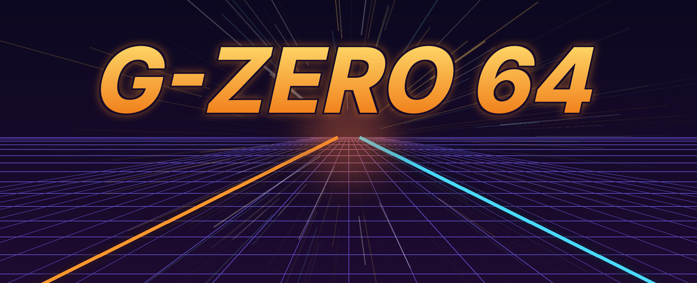
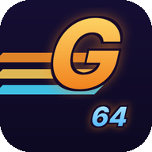

**F-Zero X con el Expansion Kit del 64DD, nativo en Android.**

---

## ¿Qué es?

**G-Zero 64** es un port para Android de [G-Diffuser](https://github.com/Zorkats/G-Diffuser), el port
nativo de **F-Zero X** (Nintendo 64) hecho por Zorkats. No es un emulador: el juego está
reconstruido a partir de su código decompilado y funciona directamente en el móvil o la consola
Android, con mejoras modernas y el **Expansion Kit** completo del 64DD (editor de circuitos y
copas extra).

Está pensado sobre todo para consolas portátiles Android con mando (Retroid, AYN Odin, Anbernic…),
aunque funciona en cualquier dispositivo compatible.

> **Estado:** primera versión en pruebas. Puede tener fallos; si encuentras alguno, abre un
> [issue](https://github.com/KB-retro/g-zero-64/issues).

**No incluye ningún archivo del juego.** Necesitas tus propias copias (ver [Archivos necesarios](#archivos-necesarios)).

## Funciones

- **Juego nativo**, sin emulación, a 60 FPS.
- **Expansion Kit del 64DD**: editor de circuitos (*Course Edit*) y las copas del disco.
- **Pantalla panorámica 16:9** real, con el marcador ajustado a los bordes.
- **Sin bordes negros**: la imagen ocupa toda la pantalla.
- **Imagen más fluida**: interpolación de fotogramas en pantallas de más de 60 Hz.
- **Opciones gráficas**: resolución interna, antialiasing, filtrado de texturas y distancia de dibujado.
- **Fantasmas**: guarda, importa y exporta tus vueltas fantasma.
- **Modo foto**: oculta el marcador con la carrera en pausa.
- **Packs de texturas**: copia packs `.o2r` en la carpeta `mods/` de la app.
- **Lanzador propio** con Jugar, Ajustes y Cambiar carpeta, e inicio automático opcional.
- **Menú rápido** dentro del juego, con el botón Atrás o con Select + Start: Continuar, Salir y
  opciones del juego.
- **Mandos** compatibles con Android (Bluetooth o integrados).

## Requisitos

- Android 11 o superior, de 64 bits (arm64).
- GPU con OpenGL ES 3.0 (cualquier Adreno, Mali o PowerVR moderna).
- Unos 300 MB libres.
- Mando recomendado (los controles táctiles llegarán más adelante).

## Archivos necesarios

Tienen que ser copias tuyas, sacadas de tus propios cartuchos y discos:

| Archivo | Qué es |
| --- | --- |
| ROM de **F-Zero X (EE. UU.)** | El cartucho americano. Vale `.z64`, `.v64` o `.n64`. La europea también funciona; la japonesa no. |
| Disco del **Expansion Kit traducido** (`.ndd`) | El disco del 64DD con la traducción al inglés de Zoinkity, adaptada por LuigiBlood. |
| **IPL del 64DD** | El chip de arranque de la unidad 64DD (japonesa o prototipo americano). |

No hace falta renombrarlos: el lanzador los reconoce por su contenido.

## Instalación

1. Descarga el archivo `G-Zero-64.apk` de la última versión.
2. Ábrelo en tu dispositivo y permite instalar apps de origen desconocido si te lo pide.
3. Copia los tres archivos del juego a una misma carpeta del almacenamiento.
4. Abre **G-Zero 64**, pulsa **Elegir carpeta** y selecciona esa carpeta. Los archivos se copian
   dentro de la app; si falta alguno, te dice cuál.
5. Pulsa **Jugar**. La primera vez prepara los gráficos y tarda un poco más.

Para actualizar, instala la nueva APK encima de la anterior: tus partidas se conservan.

Las partidas, la configuración y los packs de texturas están en
`Android/data/org.patrullaretro.gzero64/files/`.

## Controles

- **Mando**: se configura solo. Puedes cambiar los botones en el menú rápido → *Opciones del juego*.
- **Atrás** o **Select + Start**: abre el menú rápido.
- **Continuar** (verde) vuelve a la carrera y **Salir** (rojo) cierra el juego.

## Compilar la APK

La APK se genera en GitHub Actions: pestaña **Actions** → **Android APK** → **Run workflow**. Va
firmada siempre con la misma clave (secretos `GZ64_KEYSTORE_B64` y `GZ64_KEYSTORE_PASSWORD`), así
que cada versión se instala encima de la anterior. El código de Android está en
[`android/`](android/).

## Créditos

  
  &nbsp;&nbsp;&nbsp;
  

- **G-Zero 64** (port para Android, lanzador y arte): [KB-retro](https://github.com/KB-retro).
- **[G-Diffuser](https://github.com/Zorkats/G-Diffuser)** de **Zorkats**: el port nativo de PC en el que se basa todo este proyecto.
- **[inspectredc](https://github.com/inspectredc)** y colaboradores de la [decompilación de F-Zero X](https://github.com/inspectredc/fzerox): sin su trabajo nada de esto existiría.
- **Zoinkity**: traducción al inglés del Expansion Kit.
- **[LuigiBlood](https://github.com/LuigiBlood)**: adaptación de la traducción al disco del 64DD e investigación sobre el 64DD.
- **[Kenix3](https://github.com/Kenix3)** y [libultraship](https://github.com/Kenix3/libultraship): motor y renderizador.
- La comunidad de **[HarbourMasters](https://github.com/HarbourMasters)** ([Ship of Harkinian](https://github.com/HarbourMasters/Shipwright), [Starship](https://github.com/HarbourMasters/Starship)) y [Torch](https://github.com/HarbourMasters/Torch).
- **[Kiziio](https://github.com/Kiziio1)**: logo e icono de G-Diffuser.
- **[SDL](https://www.libsdl.org/)**: ventana, sonido y mandos en Android.
- Toda la comunidad de decompilación y modding de N64.

El README original de G-Diffuser, con toda su información técnica, está en
[`docs/README-G-Diffuser.md`](docs/README-G-Diffuser.md).

## Licencia y aviso legal

El código de G-Diffuser y de G-Zero 64 se publica bajo la [licencia MIT](LICENSE). Los submódulos y
componentes incluidos mantienen sus propias licencias: ver [`LICENSES/`](LICENSES/) y
[`THIRD_PARTY_NOTICES.md`](THIRD_PARTY_NOTICES.md).

Proyecto no oficial, sin relación con Nintendo ni respaldado por Nintendo. F-Zero y Nintendo son
marcas de Nintendo. G-Zero 64 no contiene ROM, disco, IPL ni ningún otro dato del juego: cada
usuario debe aportar sus propias copias legales. Los archivos que la app genera a partir de ellas
(como `fzerox.o2r`) también son datos del juego y no deben compartirse.
