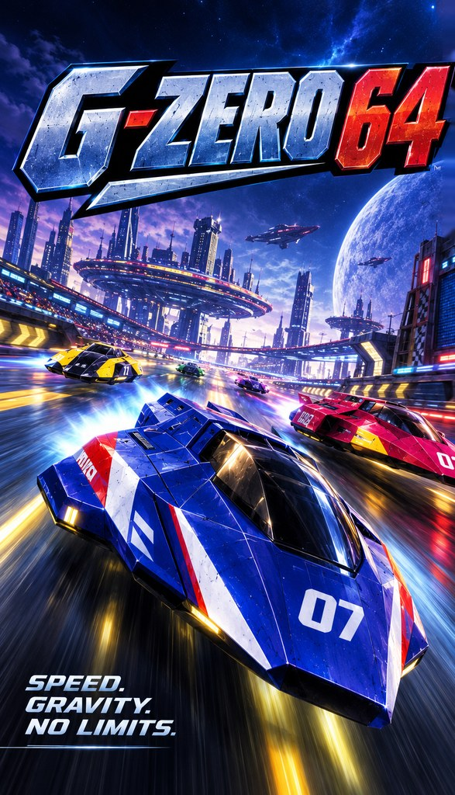

**El clásico de carreras de naves futuristas de la consola de 64 bits, nativo en Android.**

---

## ¿Qué es?

**G-Zero 64** es un port para Android de [G-Diffuser](https://github.com/Zorkats/G-Diffuser), hecho
por Zorkats, del clásico juego de carreras de naves espaciales de la consola de 64 bits. No es un
emulador: el juego está reconstruido a partir de su código decompilado y funciona directamente en
el móvil o la consola Android, con mejoras modernas y el **kit de expansión** completo de la unidad
de disco (editor de circuitos y copas extra).

Está pensado sobre todo para consolas portátiles Android con mando (Retroid, AYN Odin, Anbernic…),
aunque funciona en cualquier dispositivo compatible.

> **Estado:** primera versión en pruebas. Puede tener fallos; si encuentras alguno, abre un
> [issue](https://github.com/KB-retro/g-zero-64/issues).

> **⚠️ Importante**
>
> **Proyecto no oficial y gratuito**, sin relación con los propietarios del juego original ni
> respaldado por ellos. **No incluye ningún archivo del juego:** necesitas tu propia copia legal (ver
> [Archivos necesarios](#archivos-necesarios)). No se vende ni se acepta dinero por él.

## Funciones

- **Juego nativo**, sin emulación, a 60 FPS.
- **Kit de expansión**: editor de circuitos (*Course Edit*) y las copas extra del disco.
- **Pantalla panorámica 16:9** real, con el marcador ajustado a los bordes, o 4:3 original.
- **Sin bordes negros**: la imagen ocupa toda la pantalla.
- **Opciones gráficas**: resolución interna, FSR 1.0, FXAA, MSAA, filtrado de texturas y distancia
  de dibujado.
- **Shaders y texturas**:
  - Shaders de RetroArch elegidos para ir fluidos en portátiles: líneas de escaneo, rejilla, nitidez,
    suavizado SMAA, colores vivos y CRT retro.
  - Escalado de texturas **xBRZ** (2x, 3x o 4x).
  - **Packs de texturas HD de emulador** (`.htc` de GLideN64): si pones el pack junto a los archivos
    del juego, el lanzador lo copia y se activa solo.
- **Modo Práctica mejorado**: diferencia por vuelta y reglas de carrera única (vueltas, rivales de la
  CPU y rival al azar).
- **Modo foto**: pausa la carrera con Start, oculta el marcador y mueve la cámara libremente.
- **Fantasmas**: el fantasma de tus récords se guarda automáticamente.
- **Logros** propios, con aviso en pantalla al desbloquearlos.
- **Contador de FPS** opcional.
- **Lanzador propio** con Jugar, Ajustes y Cambiar carpeta, e inicio automático opcional.
- **Menú rápido** dentro del juego con el botón Atrás: imagen, sonido, mando y controles táctiles,
  con **Continuar** y **Salir**. El juego queda en pausa mientras está abierto.
- **Mandos** compatibles con Android (Bluetooth o integrados), con un esquema **de carreras**:
  cruceta o stick para girar, R2 acelera, A turbo, gatillo izquierdo frena, L1/R1 derrapes.
- **Controles táctiles** con editor para moverlos y cambiar su tamaño, cuadrícula y preajustes. En
  carrera cambian a un esquema de flechas con aceleración automática.
- Todo **en español** (e inglés si el sistema está en inglés).

## Requisitos

- Android 11 o superior, de 64 bits (arm64).
- GPU con OpenGL ES 3.0 (cualquier Adreno, Mali o PowerVR moderna).
- Unos 300 MB libres.
- Mando recomendado; también se puede jugar con los controles táctiles.

## Archivos necesarios

Tienen que ser copias tuyas, sacadas de tus propios cartuchos y discos:

| Archivo | Qué es |
| --- | --- |
| **ROM del juego** | El cartucho americano. Vale `.z64`, `.v64` o `.n64`. La europea también funciona; la japonesa no. |
| Disco del **kit de expansión traducido** (`.ndd`) | El disco de expansión con la traducción al inglés de Zoinkity, adaptada por LuigiBlood. |
| **IPL de la unidad de disco** | El chip de arranque de la unidad de disco (japonesa o prototipo americano). |
| Pack de texturas HD (`.htc`, opcional) | Un pack de GLideN64, por ejemplo `FZEROX_HIRESTEXTURES.htc`. |

No hace falta renombrarlos: el lanzador los reconoce por su contenido.

## Instalación

1. Descarga el archivo `G-Zero-64.apk` de la última versión.
2. Ábrelo en tu dispositivo y permite instalar apps de origen desconocido si te lo pide.
3. Copia los tres archivos del juego (y el pack HD, si tienes uno) a una misma carpeta del
   almacenamiento.
4. Abre **G-Zero 64**, pulsa **Elegir carpeta** y selecciona esa carpeta. Los archivos se copian
   dentro de la app; si falta alguno, te dice cuál.
5. Pulsa **Jugar**. La primera vez prepara los gráficos y tarda un poco más.

Para actualizar, instala la nueva APK encima de la anterior: tus partidas se conservan.

Las partidas, la configuración y el pack de texturas HD están en
`Android/data/com.gzero64/files/`.

## Controles

- **Mando**: se configura solo. En carrera usa el esquema de carreras: cruceta o stick para girar, R2
  acelera, A turbo, gatillo izquierdo frena, L1/R1 derrapes, Y mira atrás y X cambia la cámara. Se
  puede desactivar en el menú rápido → *Mando y táctil*.
- **Táctil**: los controles aparecen solos si no hay mando. Se editan desde el menú rápido.
- **Atrás**: abre el menú rápido. En él, L1/L2 van a la lista de secciones y R1/R2 a las opciones.
- **Continuar** (verde) vuelve a la carrera y **Salir** (rojo) cierra el juego.

## Compilar la APK

La APK se genera en GitHub Actions: pestaña **Actions** → **Android APK** → **Run workflow**. Va
firmada siempre con la misma clave (secretos `GZ64_KEYSTORE_B64` y `GZ64_KEYSTORE_PASSWORD`), así
que cada versión se instala encima de la anterior. El código de Android está en
[`android/`](android/).

## Créditos

  

- **G-Zero 64** (port para Android, lanzador y arte): [KB-retro](https://github.com/KB-retro).
- **[G-Diffuser](https://github.com/Zorkats/G-Diffuser)** de **Zorkats**: el port nativo de PC en el que se basa todo este proyecto.
- **[inspectredc](https://github.com/inspectredc)** y colaboradores de la [decompilación del juego original](https://github.com/inspectredc/fzerox): sin su trabajo nada de esto existiría.
- **Zoinkity**: traducción al inglés del kit de expansión.
- **[LuigiBlood](https://github.com/LuigiBlood)**: adaptación de la traducción al disco e investigación sobre la unidad de disco.
- **[Kenix3](https://github.com/Kenix3)** y [libultraship](https://github.com/Kenix3/libultraship): motor y renderizador.
- La comunidad de **[HarbourMasters](https://github.com/HarbourMasters)** ([Ship of Harkinian](https://github.com/HarbourMasters/Shipwright), [Starship](https://github.com/HarbourMasters/Starship)) y [Torch](https://github.com/HarbourMasters/Torch).
- **[Kiziio](https://github.com/Kiziio1)**: logo e icono de G-Diffuser.
- **[SDL](https://www.libsdl.org/)**: ventana, sonido y mandos en Android.
- Toda la comunidad de decompilación y modding de la consola de 64 bits.

El README original de G-Diffuser, con toda su información técnica, está en
[`docs/README-G-Diffuser.md`](docs/README-G-Diffuser.md).

## Licencia y aviso legal

El código de G-Diffuser y de G-Zero 64 se publica bajo la [licencia MIT](LICENSE). Los submódulos y
componentes incluidos mantienen sus propias licencias: ver [`LICENSES/`](LICENSES/) y
[`THIRD_PARTY_NOTICES.md`](THIRD_PARTY_NOTICES.md). La APK de Android incluye el escalador xBRZ
(GPL v3), así que la APK en conjunto se distribuye bajo la GPL v3; su código completo es este
repositorio.

Proyecto de fans no oficial, sin relación con los titulares de los derechos del juego original ni
respaldado por ellos. Las marcas pertenecen a sus propietarios. G-Zero 64 no contiene ROM, disco, IPL ni ningún otro dato del juego: cada
usuario debe aportar sus propias copias legales. Los archivos que la app genera a partir de ellas
(como `fzerox.o2r`) también son datos del juego y no deben compartirse.

G-Zero 64 es gratuito y no tiene ánimo de lucro. Si los titulares de los derechos tienen cualquier
objeción, se atenderá y se retirará el contenido afectado.
